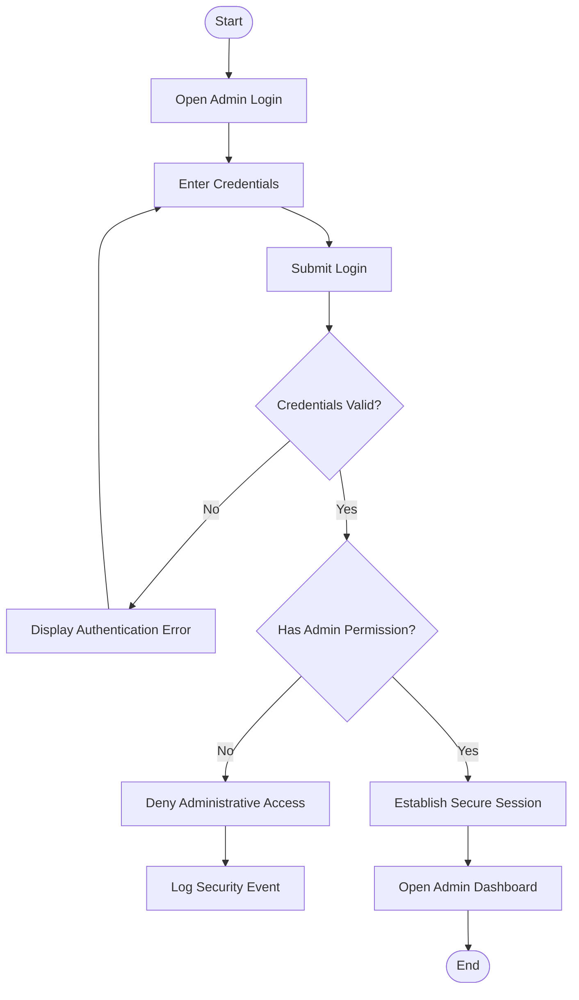
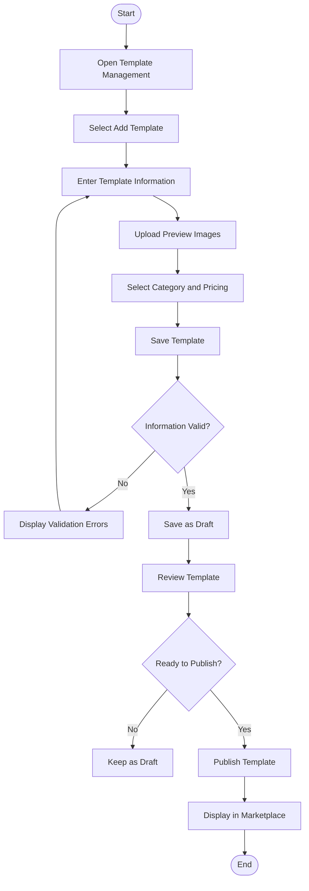
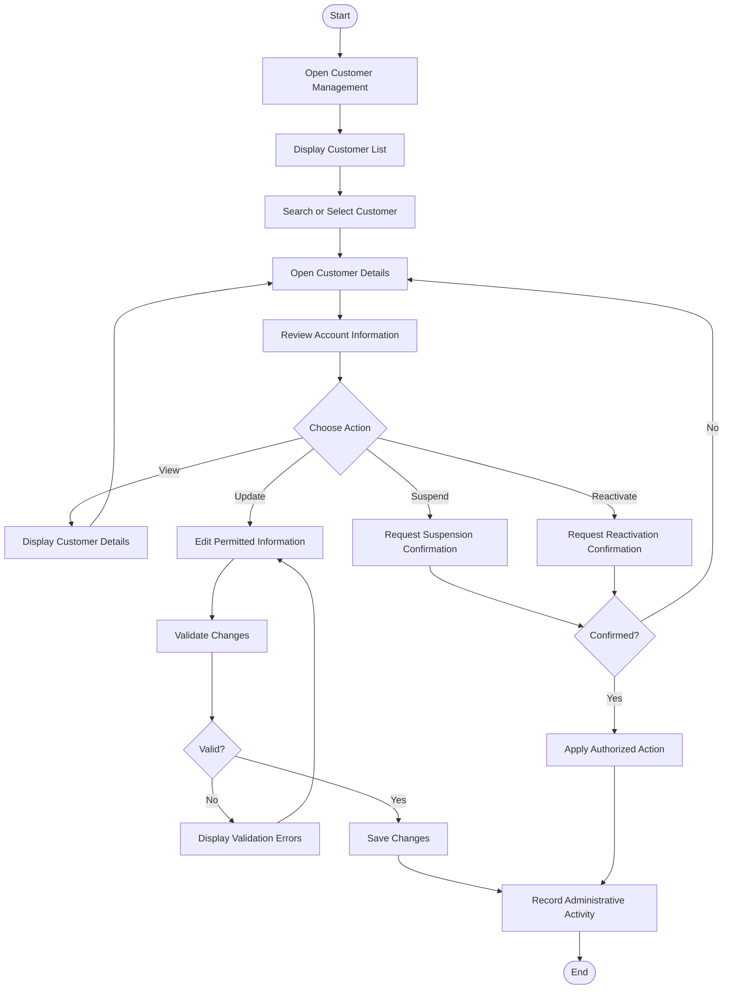
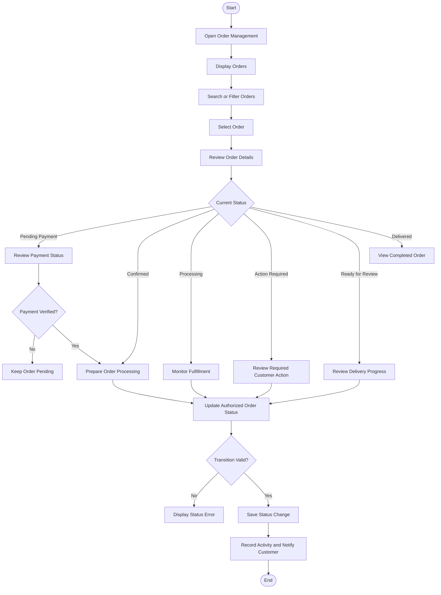
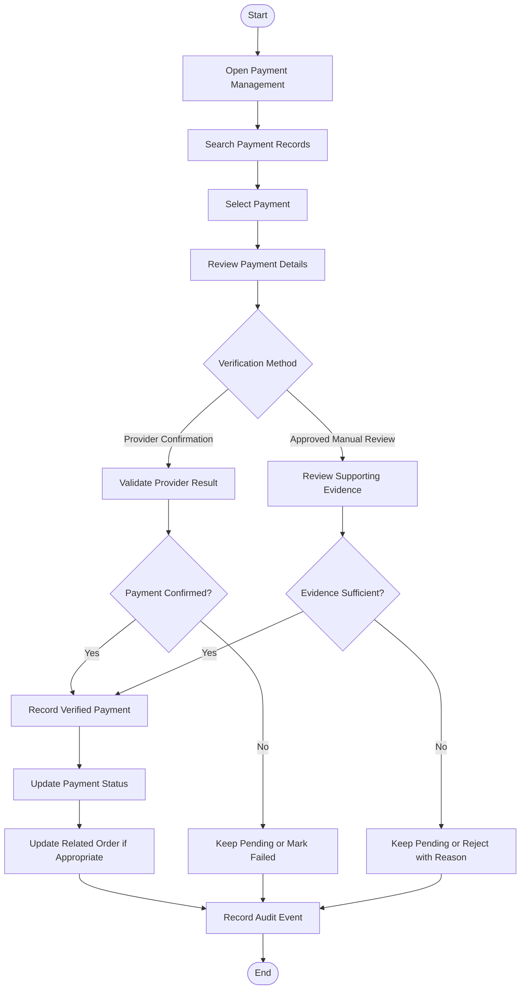
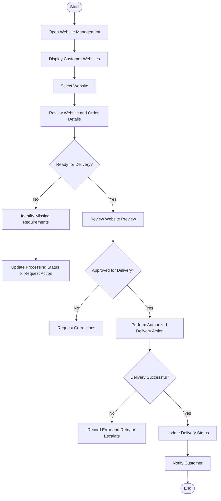
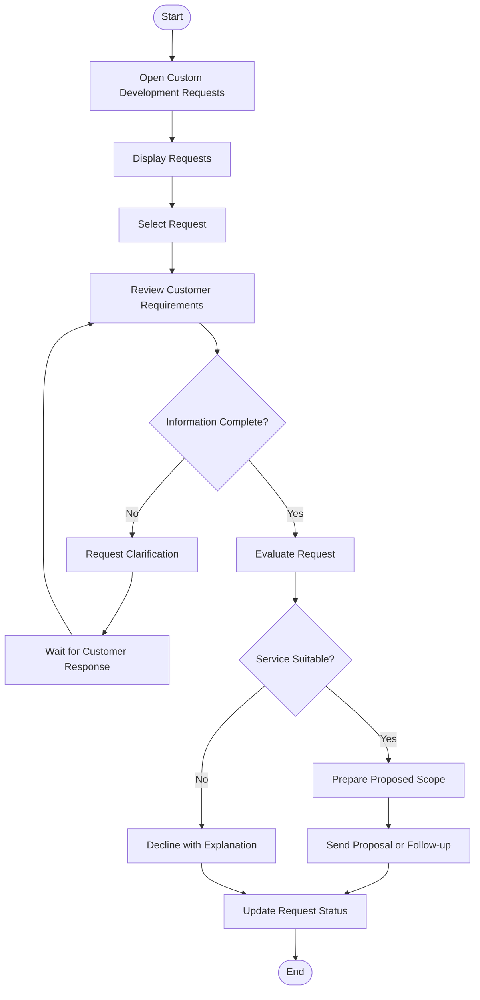
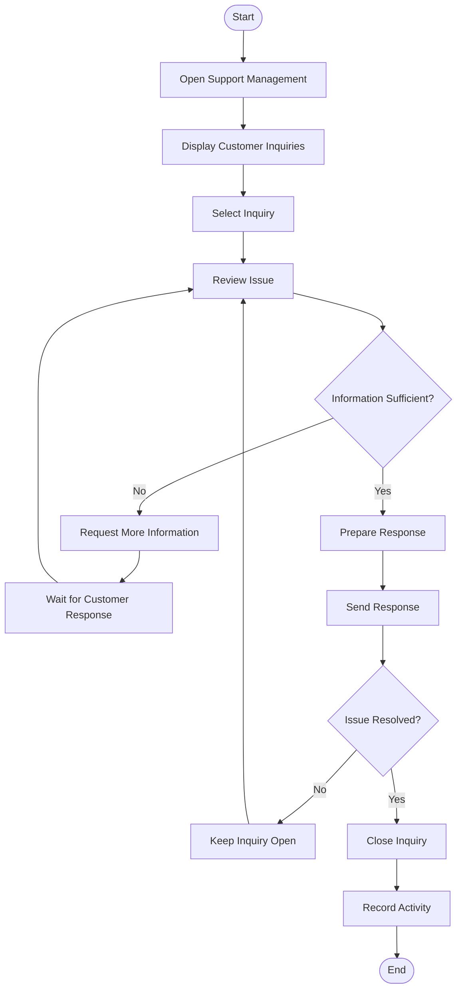

# WEBIFY — ADMIN USER FLOWS

**Project:** Webify  
**Document:** Administrator User Flows  
**Version:** 1.0  
**Date:** November 27, 2026  
**Status:** Initial Draft — Pending UI/UX Review  
**Project Owner:** Rodolph Habib

---

## 1. Introduction

### 1.1 Purpose

This document defines the workflows and interactions available to Webify administrators.

It describes how administrators access the platform, manage templates and customers, process orders and payments, oversee website delivery, and respond to customer inquiries.

The document will guide the design of the Webify administrative dashboard and help identify the required screens, actions, permissions, validation rules, and error states.

### 1.2 Scope

This document covers eight main administrative workflows:

1. Administrator login and dashboard access.
2. Template management.
3. Customer management.
4. Order management.
5. Payment verification and management.
6. Customer website and delivery management.
7. Custom-development request management.
8. Customer support and inquiry management.

### 1.3 Administrator Responsibilities

The Webify administrator is responsible for:

- Maintaining the template marketplace.
- Managing customer accounts.
- Reviewing and processing customer orders.
- Monitoring and verifying payment records.
- Managing website delivery.
- Reviewing custom-development requests.
- Responding to customer inquiries.
- Monitoring platform activity.

### 1.4 Access and Permissions

Administrative functionality must be restricted to authenticated and authorized users.

The platform should support role-based access control (RBAC), allowing different administrative permissions where necessary.

For the initial MVP, a small number of trusted administrators may manage the platform, but the system should not assume that every administrator has unrestricted access.

---

## 2. Flow 1 — Administrator Login and Dashboard Access

### 2.1 Objective

Allow authorized administrators to securely access the Webify administrative dashboard.

### 2.2 Main Flow

1. Administrator opens the admin login page.
2. Administrator enters their credentials.
3. Administrator submits the login form.
4. Webify validates the credentials.
5. Webify verifies that the account has administrator permissions.
6. The system establishes a secure authenticated session.
7. Administrator is redirected to the admin dashboard.
8. Dashboard displays relevant platform information and management options.

### 2.3 Flow Diagram

### 2.4 Alternative Paths

- Administrator enters incorrect credentials.
- Administrator's account is disabled.
- Administrator attempts to access the dashboard without logging in.
- Administrator's session expires.
- Administrator does not have the required permission.
- Administrator logs out.

### 2.5 Error and Security States

| Situation | Expected System Behavior |
|---|---|
| Incorrect credentials | Display a generic authentication error |
| Unauthorized account | Deny access to the admin dashboard |
| Disabled administrator | Prevent login and display an appropriate message |
| Expired session | Redirect to admin login |
| Network failure | Display a retry option |
| Repeated failed attempts | Apply rate limiting and log relevant security events |

### 2.6 Security Requirements

- Administrative routes must be protected on the backend.
- Administrative permissions must be checked for every protected operation.
- Administrative sessions must use secure session management.
- Important administrative actions must be logged.
- Administrative credentials must never be exposed in frontend code.

---

## 3. Flow 2 — Template Management

### 3.1 Objective

Allow administrators to create, update, review, publish, unpublish, and organize website templates in the Webify marketplace.

### 3.2 Main Flow — Add a Template

1. Administrator opens the admin dashboard.
2. Administrator selects Template Management.
3. Administrator selects Add Template.
4. Webify displays the template creation form.
5. Administrator enters the template name and description.
6. Administrator selects a category.
7. Administrator provides the template preview images.
8. Administrator enters pricing and other required information.
9. Administrator saves the template as a draft.
10. Webify validates the submitted information.
11. Administrator reviews the template.
12. Administrator publishes the template when it is ready.
13. The published template becomes visible in the marketplace.

### 3.3 Flow Diagram

### 3.4 Other Template Management Actions

**Edit Template**

1. Administrator opens the template list.
2. Administrator selects a template.
3. Administrator chooses Edit.
4. Administrator modifies the permitted information.
5. Administrator saves changes.
6. Webify validates and saves the updated information.

**Unpublish Template**

1. Administrator selects a published template.
2. Administrator chooses Unpublish.
3. Webify requests confirmation.
4. Administrator confirms.
5. Webify removes the template from public marketplace listings.

Unpublishing a template must not automatically delete existing customer orders or customer-owned websites.

### 3.5 Alternative Paths

- Administrator saves a template as a draft.
- Administrator cancels template creation.
- Administrator uploads an unsupported image.
- Administrator enters invalid pricing information.
- Administrator attempts to publish incomplete information.
- Administrator edits an existing template.
- Administrator attempts to delete a template associated with existing orders.

### 3.6 Error and Validation States

| Situation | Expected System Behavior |
|---|---|
| Missing required information | Highlight missing fields |
| Duplicate template slug | Request a unique slug |
| Unsupported image format | Reject the upload |
| Image exceeds upload limit | Display the maximum allowed file size |
| Invalid price | Reject the submitted value |
| Save operation fails | Preserve entered information where possible |
| Template has existing orders | Prevent unsafe deletion and explain the restriction |

### 3.7 Important Requirements

- Templates should have draft, published, and unpublished states.
- Only authorized administrators may manage templates.
- Uploaded files must be validated.
- Template prices must be stored using appropriate decimal monetary types.
- Template changes must not silently overwrite customer-owned website versions.
- Existing order records must preserve the agreed purchase information.

---

## 4. Flow 3 — Customer Management

### 4.1 Objective

Allow administrators to view customer accounts, review customer information, and perform authorized account-management actions.

### 4.2 Main Flow

1. Administrator opens Customer Management.
2. Webify displays the customer list.
3. Administrator searches for a customer or selects one from the list.
4. Webify displays the customer's account details.
5. Administrator reviews relevant account information.
6. Administrator selects an authorized action.
7. Webify validates the action.
8. If confirmation is required, Webify requests confirmation.
9. Administrator confirms the action.
10. Webify updates the account and records the administrative activity.

### 4.3 Flow Diagram

### 4.4 Alternative Paths

- Administrator searches for a customer.
- Administrator views customer order history.
- Administrator updates permitted account information.
- Administrator suspends an account when justified and authorized.
- Administrator reactivates a previously suspended account.
- Administrator cancels an action before confirmation.
- Administrator cannot find the requested customer.

### 4.5 Error and Validation States

| Situation | Expected System Behavior |
|---|---|
| Customer not found | Display a no-results message |
| Invalid account update | Display validation errors |
| Unauthorized administrator | Deny the requested action |
| Account already suspended | Display current account status |
| Account has active orders | Warn before applying an action that may affect service |
| Update fails | Display an error and allow retry |

### 4.6 Important Requirements

- Administrators should only access information required for their responsibilities.
- Sensitive customer information must be protected.
- Account suspension must not automatically delete customer data or orders.
- Important account changes must be recorded.
- Customer ownership and account relationships must remain consistent.

---

## 5. Flow 4 — Order Management

### 5.1 Objective

Allow administrators to review, process, update, and monitor customer orders.

### 5.2 Main Flow

1. Administrator opens Order Management.
2. Webify displays the list of orders.
3. Administrator searches or filters orders.
4. Administrator selects an order.
5. Webify displays the order details.
6. Administrator reviews the customer, selected template, agreed price, payment status, and order history.
7. Administrator determines the appropriate next action.
8. Administrator updates the order status if authorized.
9. Webify validates the status transition.
10. Webify saves the change.
11. The updated status becomes visible to the customer.

### 5.3 Flow Diagram

### 5.4 Alternative Paths

- Administrator searches by order reference.
- Administrator filters orders by status.
- Administrator views an order without changing it.
- Administrator requests additional customer information.
- Administrator cancels an order according to the applicable policy.
- Administrator reviews a delayed order.
- Administrator attempts an invalid status transition.

### 5.5 Proposed Order Statuses

| Status | Description |
|---|---|
| Pending Payment | Payment has not been confirmed |
| Payment Under Review | Payment verification is in progress |
| Confirmed | Order has been accepted and payment requirements are satisfied |
| Processing | Order fulfillment is underway |
| Action Required | Customer must provide information or take action |
| Ready for Review | Website preview is available for customer review |
| Delivered | Website delivery is completed |
| Cancelled | Order has been cancelled |
| Refunded | Order has an associated refund |

The system must enforce valid status transitions rather than allowing arbitrary status changes.

### 5.6 Error and Validation States

| Situation | Expected System Behavior |
|---|---|
| Order not found | Display a no-results message |
| Invalid status transition | Reject the change |
| Payment not confirmed | Prevent fulfillment actions that require payment |
| Missing customer information | Request the required information |
| Unauthorized status change | Deny the action |
| Update failure | Preserve the previous valid status |
| Duplicate action | Prevent duplicate processing |

### 5.7 Important Requirements

- Each order must have a unique reference.
- Order details must preserve the agreed price and currency.
- Status changes must be recorded.
- Only authorized users may update order statuses.
- Customers should be able to view relevant order progress.
- Payment and order statuses must remain separate.

---

## 6. Flow 5 — Payment Verification and Management

### 6.1 Objective

Allow authorized administrators to review payment records and verify payments when manual verification is required.

### 6.2 Main Flow — Payment Review

1. Administrator opens Payment Management.
2. Webify displays payment records.
3. Administrator filters or searches for a payment.
4. Administrator selects a payment record.
5. Webify displays the payment details.
6. Administrator reviews the associated order and payment information.
7. If provider verification is available, Webify uses the provider's verified result.
8. If manual verification is permitted, the administrator reviews the required supporting evidence.
9. Administrator confirms or rejects the payment only when authorized and supported by evidence.
10. Webify updates the payment record.
11. Webify records the verification activity.
12. The associated order progresses only when its business rules are satisfied.

### 6.3 Flow Diagram

### 6.4 Alternative Paths

- Payment is confirmed automatically by the provider.
- Payment remains pending.
- Payment fails.
- Customer submits supporting payment information.
- Administrator requests further evidence.
- Administrator cannot verify a payment.
- Administrator identifies a duplicate payment record.
- Customer requests a refund.

### 6.5 Error and Validation States

| Situation | Expected System Behavior |
|---|---|
| Payment not found | Display a no-results message |
| Invalid payment reference | Keep the payment unverified |
| Insufficient evidence | Keep pending or reject with a recorded reason |
| Provider verification unavailable | Keep payment pending |
| Duplicate payment notification | Prevent duplicate processing |
| Unauthorized verification | Deny the action |
| Refund request received | Follow the approved refund workflow |

### 6.6 Important Security Requirements

- Never store raw card numbers or CVV values.
- Payment provider confirmations must be validated on the backend.
- Webhook signatures must be verified.
- Payment updates must be idempotent.
- Manual verification must be restricted to authorized personnel.
- Verification actions must be recorded in an audit log.
- Refunds must follow the approved refund policy and payment-provider process.
- Administrators must not be able to mark payments as paid without a valid verification basis.

---

## 7. Flow 6 — Customer Website and Delivery Management

### 7.1 Objective

Allow administrators to monitor customer websites, review delivery progress, and manage authorized website delivery actions.

### 7.2 Main Flow

1. Administrator opens Website Management.
2. Webify displays customer website records.
3. Administrator searches or selects a website.
4. Webify displays website details.
5. Administrator reviews the customer, associated order, website status, and version information.
6. Administrator checks whether the website is ready for delivery.
7. If required, administrator reviews the website preview.
8. Administrator performs the authorized delivery or publishing action.
9. Webify validates the action.
10. Webify updates the website delivery status.
11. Customer receives the appropriate status update.

### 7.3 Flow Diagram

### 7.4 Alternative Paths

- Website is not ready for delivery.
- Customer needs to provide additional information.
- Website preview requires corrections.
- Publishing fails.
- Website delivery is delayed.
- Administrator needs to retry an operation.
- Administrator views a previously delivered website.

### 7.5 Error and Validation States

| Situation | Expected System Behavior |
|---|---|
| Website not found | Display a no-results message |
| Associated order not eligible | Prevent delivery |
| Website content is invalid | Prevent publishing and display errors |
| Publishing fails | Record the failure and allow authorized retry |
| Customer ownership mismatch | Deny access |
| Delivery action duplicated | Prevent duplicate publishing operations |
| Website is already delivered | Display its current delivery status |

### 7.6 Important Requirements

- Website ownership must be verified.
- Delivery actions must require appropriate authorization.
- Customer website versions must be preserved.
- Publishing must validate the website content.
- Delivery status must be visible to the customer.
- Administrative actions must be recorded.
- Failed delivery operations must be recoverable where possible.

---

## 8. Flow 7 — Custom-Development Request Management

### 8.1 Objective

Allow administrators to review and manage customer requests for custom website development services.

### 8.2 Main Flow

1. Administrator opens Custom Development Requests.
2. Webify displays submitted requests.
3. Administrator selects a request.
4. Webify displays the customer's requirements and contact information.
5. Administrator reviews the requested work.
6. Administrator updates the request status.
7. If clarification is required, administrator contacts the customer.
8. Administrator prepares or coordinates the proposed service scope.
9. Customer receives an appropriate response.
10. Request status is updated according to the outcome.

### 8.3 Flow Diagram

### 8.4 Proposed Request Statuses

- New
- Under Review
- Awaiting Customer Information
- Proposal Sent
- Accepted
- Declined
- Closed

### 8.5 Error and Validation States

| Situation | Expected System Behavior |
|---|---|
| Request not found | Display a no-results message |
| Missing customer information | Request clarification |
| Invalid request status transition | Reject the update |
| Customer contact unavailable | Record the communication issue |
| Request already closed | Prevent unintended changes |
| Update fails | Display an error and allow retry |

### 8.6 Important Requirements

- Customer requests must be linked to their associated customer accounts.
- Request details should be accessible only to authorized personnel.
- Changes to request status must be recorded.
- Proposed service scope and pricing should be communicated clearly.
- A request must not automatically become a paid order without the appropriate customer agreement and order process.

---

## 9. Flow 8 — Customer Support and Inquiry Management

### 9.1 Objective

Allow administrators to review customer inquiries, respond to requests, and track support progress.

### 9.2 Main Flow

1. Administrator opens Support Management.
2. Webify displays customer inquiries.
3. Administrator filters or searches inquiries.
4. Administrator selects an inquiry.
5. Webify displays the inquiry details and associated customer information.
6. Administrator reviews the issue.
7. Administrator responds or requests additional information.
8. Administrator updates the inquiry status.
9. Customer receives the response through the available communication method.
10. Administrator closes the inquiry when the issue is resolved.

### 9.3 Flow Diagram

### 9.4 Proposed Support Statuses

- New
- Open
- In Progress
- Awaiting Customer Response
- Resolved
- Closed

### 9.5 Error and Validation States

| Situation | Expected System Behavior |
|---|---|
| Inquiry not found | Display a no-results message |
| Customer information unavailable | Display an appropriate warning |
| Response submission fails | Preserve the response where possible and allow retry |
| Unauthorized inquiry access | Deny access |
| Inquiry already closed | Display its current status |
| Customer response delayed | Keep the inquiry in its current appropriate status |

### 9.6 Important Requirements

- Support inquiries must be linked to the relevant customer.
- Customer information must be protected.
- Administrators should be able to view inquiry history.
- Support status changes should be recorded.
- Customer responses should be communicated through the supported notification or communication mechanism.

---

## 10. Administrative Dashboard Overview

The administrator dashboard should provide an overview of the platform's operations.

### 10.1 Proposed Dashboard Information

| Dashboard Section | Information |
|---|---|
| Total Customers | Number of registered customers |
| Total Templates | Number of available templates |
| Published Templates | Number of published templates |
| Total Orders | Number of submitted orders |
| Pending Orders | Orders awaiting action |
| Pending Payments | Payments awaiting verification |
| Websites in Progress | Websites currently being prepared |
| Delivered Websites | Websites successfully delivered |
| Recent Activity | Recent administrative and platform events |

Dashboard metrics should be based on actual database records and clearly defined business rules.

### 10.2 Dashboard Navigation

The administrator dashboard should provide navigation to:

- Overview
- Template Management
- Customer Management
- Order Management
- Payment Management
- Website Management
- Custom Development Requests
- Support Management
- Administrator Settings

---

## 11. Administrative Permissions and Audit Logging

### 11.1 Role-Based Access Control

The platform should use role-based permissions to control administrative actions.

Potential roles include:

| Role | Responsibilities |
|---|---|
| Super Administrator | Full platform administration and permission management |
| Template Manager | Manage marketplace templates |
| Order Manager | Review and process customer orders |
| Payment Manager | Review and verify payment records |
| Support Administrator | Manage customer inquiries |

These roles are proposed for future flexibility. The initial MVP may start with a smaller number of administrator accounts and roles.

### 11.2 Audit Logging

Important administrative actions should generate audit records.

Examples include:

- Administrator login and logout events.
- Template creation and publication.
- Template updates and unpublishing.
- Customer account suspension and reactivation.
- Order status changes.
- Payment verification and refund actions.
- Website delivery and publishing.
- Custom-development request updates.
- Support inquiry status changes.
- Permission changes.

Audit records should include, where appropriate:

- Administrator identifier.
- Action performed.
- Affected record identifier.
- Timestamp.
- Previous and new values for relevant changes.
- Action outcome.

Audit records must be protected from unauthorized modification.

---

## 12. Global Administrative Interaction Requirements

The following requirements apply to all administrative workflows.

### 12.1 Navigation

- Administrative pages must use consistent navigation.
- The current section should be clearly identified.
- Search and filtering should be available for large record lists.
- Important actions should be easy to locate.
- The interface should provide clear confirmation before destructive or sensitive operations.

### 12.2 Feedback and System States

The administrative interface should provide:

- Loading indicators.
- Success messages.
- Validation errors.
- Empty states.
- Failure notifications.
- Retry actions where appropriate.
- Confirmation dialogs for sensitive operations.
- Clear status labels.

### 12.3 Security

- All administrative actions must be authorized on the backend.
- Administrators must only access permitted information.
- Sensitive operations must be logged.
- Customer data must remain protected.
- Payment operations must follow secure verification procedures.
- Administrative sessions must be securely managed.

### 12.4 Responsive Design

The administrative dashboard should support desktop and tablet screens.

Important administrative operations should remain usable on smaller screens, but complex management interfaces should prioritize desktop usability.

---

## 13. Administrative Flow Priority

| Flow | Priority | Reason |
|---|---|---|
| Administrator Login | P0 | Required for secure dashboard access |
| Template Management | P0 | Required to maintain marketplace content |
| Customer Management | P0 | Required for account administration |
| Order Management | P0 | Required for order fulfillment |
| Payment Management | P0 | Required for payment verification |
| Website Delivery Management | P0 | Required to complete customer orders |
| Custom-Development Requests | P1 | Supports additional development services |
| Support Management | P1 | Supports customer assistance |

The P1 classification is a proposed MVP prioritization and must be reconciled with the approved MVP requirements before implementation.

---

## 14. Assumptions and Decisions Requiring Review

The following decisions must be confirmed during the design and requirements review:

1. Whether Webify will initially have one administrator role or multiple specialized roles.
2. Whether template publishing requires an additional approval step.
3. Whether manual payment verification will be supported.
4. Which order status transitions administrators may perform.
5. Whether refunds can be initiated from the dashboard or must be handled through the payment provider.
6. Whether website publishing will initially be manual or automated.
7. Whether custom-development requests will use a dedicated proposal and approval workflow.
8. Whether support inquiries will use a ticketing system or a simpler contact-management interface.
9. Which administrative actions require confirmation or additional authorization.

These decisions should be reflected in the relevant requirements and security documentation before development.

---

## 15. Acceptance Criteria

This document is ready for UI/UX review when:

- [ ] Administrator login and dashboard access are documented.
- [ ] Template management flow is documented.
- [ ] Customer management flow is documented.
- [ ] Order management flow is documented.
- [ ] Payment verification flow is documented.
- [ ] Website delivery management flow is documented.
- [ ] Custom-development request management flow is documented.
- [ ] Customer support management flow is documented.
- [ ] Decision points and alternative paths are included.
- [ ] Error and validation states are documented.
- [ ] Administrative permissions are identified.
- [ ] Audit logging requirements are documented.
- [ ] Flows are consistent with the Webify sitemap.
- [ ] Flows are consistent with the MVP scope.

---

## 16. Conclusion

This document establishes the initial administrative workflows for Webify.

It defines how administrators access the platform, manage marketplace content, oversee customer activity, process orders and payments, coordinate website delivery, and handle customer requests.

These workflows will guide the design of the administrative dashboard, wireframes, and interactive prototypes.

**Document Status:** Initial Draft — Pending UI/UX Review.

