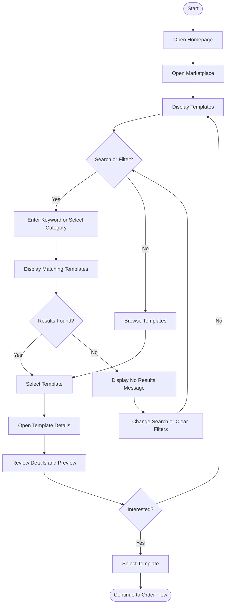
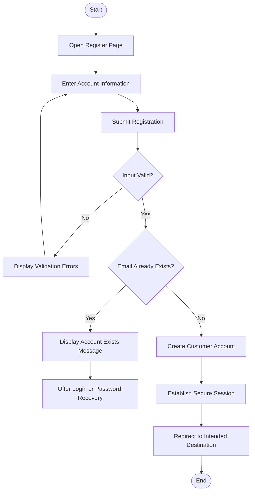
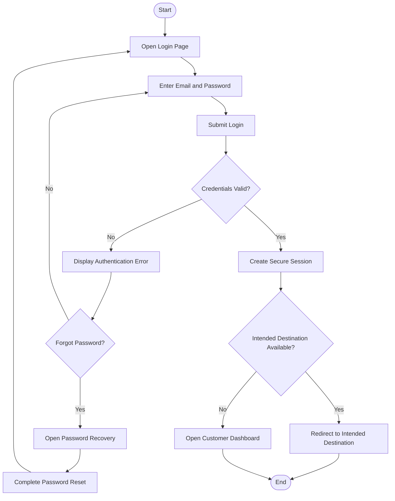
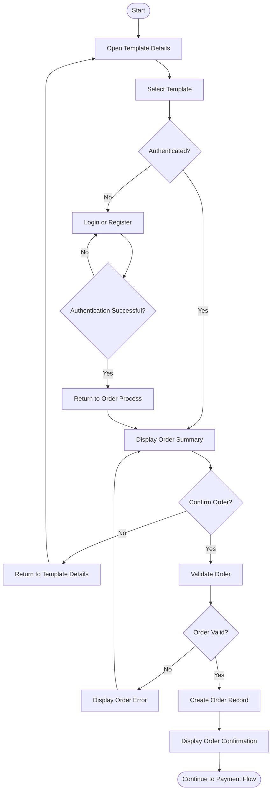
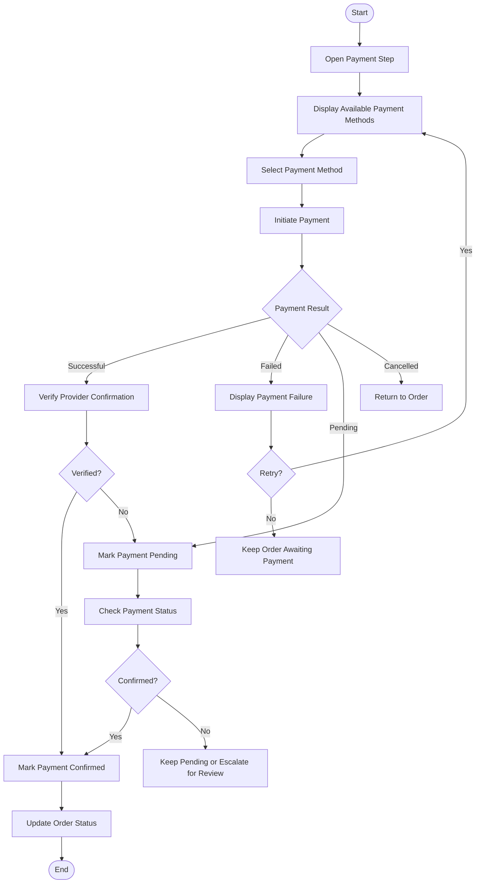
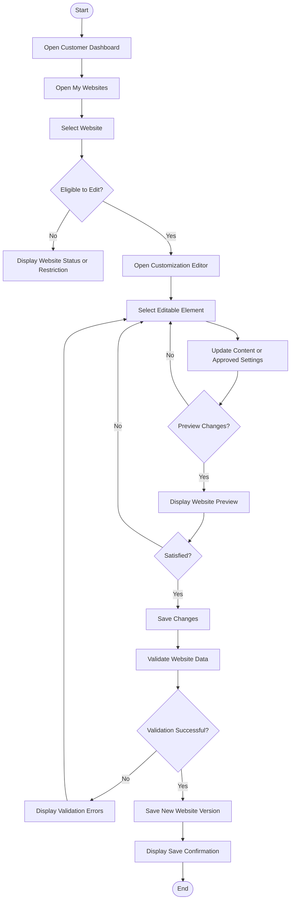
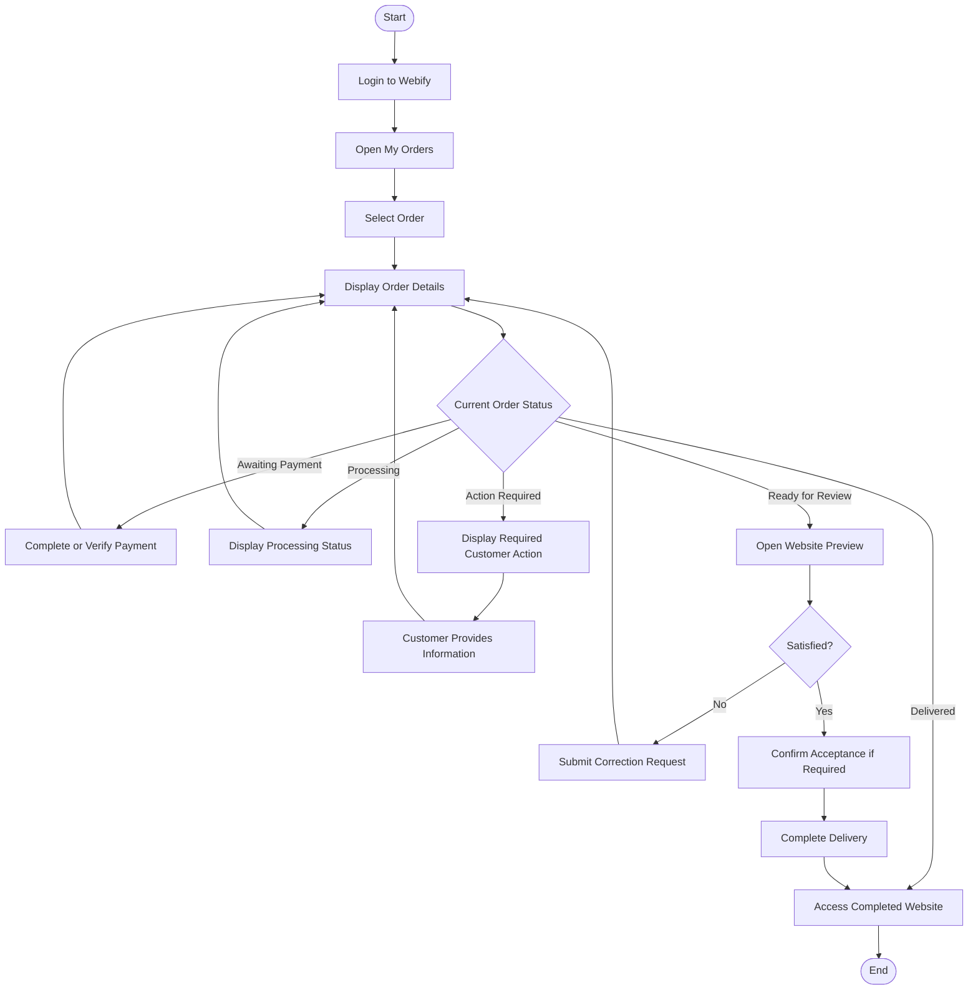

# WEBIFY — CUSTOMER USER FLOWS

**Project:** Webify  
**Document:** Customer User Flows  
**Version:** 1.0  
**Date:** November 27, 2026  
**Status:** Initial Draft — Pending UI/UX Review  
**Project Owner:** Rodolph Habib

---

## 1. Introduction

### 1.1 Purpose

This document defines the customer journeys and interactions within the Webify platform.

It describes how customers navigate between pages, perform actions, make decisions, and respond to successful or unsuccessful operations.

The document will guide the design of Webify's user interface and help identify the necessary screens, interactions, validation rules, and error states before development.

### 1.2 Scope

This document covers the following customer journeys:

1. Discover and browse website templates.
2. Register and log in.
3. Select a template and submit an order.
4. Complete or verify payment.
5. Customize, preview, and save a website.
6. Track an order and receive website delivery.

### 1.3 Target Users

The flows are designed primarily for:

- Small business owners.
- Freelancers and independent professionals.
- Startup founders and entrepreneurs.
- Content creators and organizations.

The administrator has a separate set of operational workflows, documented independently.

---

## 2. Flow 1 — Discover and Browse Templates

### 2.1 Objective

Allow visitors to discover website templates, browse categories, search for suitable designs, and review template details before making a selection.

### 2.2 Entry Point

The customer visits the Webify homepage.

### 2.3 Main Flow

1. Customer opens the Webify homepage.
2. Customer selects the Marketplace option.
3. Webify displays available website templates.
4. Customer browses the available templates.
5. Customer optionally selects a category.
6. Customer optionally enters a search keyword.
7. Webify displays matching templates.
8. Customer selects a template.
9. Webify opens the template details page.
10. Customer reviews the description, features, pricing, and available previews.
11. Customer selects the option to use or order the template.

### 2.4 Flow Diagram

### 2.5 Alternative Paths

- Customer browses without using search.
- Customer filters templates by category.
- Customer searches using keywords.
- Customer receives no search results and changes the search.
- Customer returns to the marketplace without selecting a template.
- Customer opens a template preview before deciding.

### 2.6 Error and Empty States

| Situation | Expected System Behavior |
|---|---|
| No templates available | Display a helpful empty-state message |
| No search results | Display a no-results message and allow the customer to clear filters |
| Search request fails | Display an error message and allow retry |
| Template details unavailable | Display an appropriate unavailable-page message |
| Preview fails to load | Display a fallback message and retry option |
| Invalid template URL | Display a 404 page |

---

## 3. Flow 2 — Customer Registration and Login

### 3.1 Objective

Allow visitors to create an account or log into an existing account before submitting an order.

### 3.2 Registration Flow

1. Customer selects Register.
2. Webify displays the registration form.
3. Customer enters their name, email address, and password.
4. Customer submits the form.
5. Webify validates the submitted information.
6. If validation succeeds, the system creates the customer account.
7. Webify establishes an authenticated session.
8. Customer is redirected to the intended destination, such as the selected template or checkout process.

### 3.3 Registration Flow Diagram

### 3.4 Login Flow

1. Customer opens the Login page.
2. Customer enters their registered email and password.
3. Customer submits the form.
4. Webify validates the credentials.
5. If authentication succeeds, the system establishes a secure session.
6. Customer is redirected to the intended destination or dashboard.

### 3.5 Login Flow Diagram

### 3.6 Alternative Paths

- Customer already has an account and selects Login.
- Customer forgets their password and uses password recovery.
- Customer attempts to register with an existing email.
- Customer enters incorrect login credentials.
- Customer attempts to access a protected page without authentication.
- Customer logs out and must authenticate again to access protected features.

### 3.7 Error and Validation States

| Situation | Expected System Behavior |
|---|---|
| Required field missing | Highlight the field and explain what is required |
| Invalid email format | Display an email validation message |
| Weak password | Explain the password requirements |
| Existing email during registration | Suggest logging in or recovering the password |
| Incorrect credentials | Display a generic authentication error |
| Network failure | Display a retry option |
| Expired session | Request authentication again |
| Password reset token expired | Allow the customer to request a new reset link |

### 3.8 Security Considerations

- Passwords must be securely hashed.
- Authentication must be handled by the backend.
- Login attempts should be rate-limited.
- Password recovery tokens must be securely generated and expire.
- Authentication errors should not reveal whether an email address is registered.
- Protected pages must verify authentication and authorization.

---

## 4. Flow 3 — Select a Template and Submit an Order

### 4.1 Objective

Allow a customer to select a template, review its information, authenticate if necessary, and submit an order.

### 4.2 Main Flow

1. Customer opens a template details page.
2. Customer reviews the template description, features, previews, and pricing.
3. Customer selects the order or use-template option.
4. Webify checks whether the customer is authenticated.
5. If not authenticated, Webify redirects the customer to Login or Register.
6. After authentication, the customer returns to the intended order process.
7. Webify displays the order summary.
8. Customer reviews the selected template and order information.
9. Customer confirms the order.
10. Webify creates an order record.
11. Webify displays the order confirmation and reference number.
12. Customer continues to the payment process.

### 4.3 Flow Diagram

### 4.4 Alternative Paths

- Customer is already authenticated.
- Customer needs to register before ordering.
- Customer decides not to proceed.
- Selected template becomes unavailable before order submission.
- Customer attempts to submit the same order multiple times.
- Customer loses connection while submitting an order.

### 4.5 Error and Validation States

| Situation | Expected System Behavior |
|---|---|
| Template unavailable | Prevent order submission and explain the issue |
| Missing order information | Highlight required fields |
| Order submission fails | Display an error and allow safe retry |
| Duplicate submission | Prevent duplicate orders through server-side idempotency |
| Authentication expires | Request login and preserve the intended action |
| Template price changes | Display the current price and require customer confirmation |

### 4.6 Order Requirements

Every order should contain:

- Unique order reference.
- Customer reference.
- Selected template reference.
- Agreed price and currency.
- Order creation date.
- Current order status.
- Associated payment status.

The agreed price should be recorded with the order so that future template price changes do not silently change an existing order.

---

## 5. Flow 4 — Complete or Verify Payment

### 5.1 Objective

Allow customers to complete the payment process or follow an approved alternative payment-verification process.

The exact payment method depends on the provider selected and its eligibility and approval for Webify.

### 5.2 Main Flow

1. Customer reaches the payment step after creating an order.
2. Webify displays available payment methods.
3. Customer selects an available method.
4. Webify initiates the payment process.
5. Customer completes the required payment action.
6. The payment provider or approved verification process returns a result.
7. Webify validates the payment result.
8. The payment record is updated.
9. The customer sees the payment status.
10. If payment is confirmed, the order progresses according to the fulfillment workflow.

### 5.3 Flow Diagram

### 5.4 Alternative Payment Paths

**Provider payment**

- Customer pays through an approved payment provider.
- Webify verifies the provider's server-side confirmation or signed webhook.
- The payment record is updated only after successful verification.

**Manual payment verification, if approved**

- Customer follows the payment instructions displayed by Webify.
- Customer submits any required payment reference or supporting information.
- Payment remains pending until an authorized administrator verifies it.
- Customer receives an updated status after verification.

Manual verification must only be offered if it is legally and operationally approved.

### 5.5 Payment Statuses

| Status | Meaning |
|---|---|
| Pending | Payment has not yet been confirmed |
| Processing | Payment verification is in progress |
| Paid | Payment has been successfully verified |
| Failed | Payment attempt was unsuccessful |
| Cancelled | Payment was cancelled |
| Refunded | Payment has been refunded, where applicable |

### 5.6 Error and Recovery States

| Situation | Expected System Behavior |
|---|---|
| Provider unavailable | Inform the customer and allow retry later |
| Payment declined | Display a helpful failure message |
| Payment result delayed | Keep status pending and allow status checking |
| Duplicate payment notification | Process idempotently without duplicate records |
| Invalid webhook signature | Reject the notification and log the security event |
| Payment reference cannot be verified | Keep payment pending for investigation |
| Customer closes payment page | Preserve the order and allow payment status checking |

### 5.7 Important Security Requirements

- Never store raw card numbers or CVV values.
- Verify payment results on the backend.
- Verify provider webhook signatures.
- Use idempotency to prevent duplicate payment processing.
- Keep payment records separate from order records.
- Maintain a record of payment status changes.
- Do not mark an order as paid based only on a browser redirect.

---

## 6. Flow 5 — Customize, Preview, and Save a Website

### 6.1 Objective

Allow customers with an eligible website order to customize approved website content, preview the result, and save their changes.

### 6.2 Main Flow

1. Customer logs into Webify.
2. Customer opens My Websites.
3. Customer selects an eligible website.
4. Webify opens the website details page.
5. Customer selects Edit Website.
6. Webify opens the controlled customization editor.
7. Customer selects an editable website element.
8. Customer updates permitted content, such as text, images, approved colors, buttons, or links.
9. Customer selects Preview.
10. Webify displays the updated website.
11. Customer reviews the result.
12. Customer chooses whether to continue editing or save changes.
13. Webify validates the submitted website data.
14. If validation succeeds, the system saves a new website version.
15. Webify displays a successful save message.

### 6.3 Flow Diagram

### 6.4 Editable Elements in the MVP

The controlled editor should initially support:

- Text content.
- Images.
- Approved color settings.
- Buttons.
- Links.
- Contact information.
- Other explicitly approved component properties.

The initial editor does not provide unrestricted access to website source code or arbitrary JavaScript execution.

### 6.5 Alternative Paths

- Customer opens a website that is not yet eligible for customization.
- Customer makes changes and decides not to save.
- Customer previews changes multiple times.
- Customer encounters validation errors and corrects them.
- Customer loses connection while saving.
- Customer returns to the editor after saving.
- Customer attempts to edit a website they do not own.

### 6.6 Error and Validation States

| Situation | Expected System Behavior |
|---|---|
| Website not eligible for editing | Explain the current restriction |
| Customer lacks ownership | Deny access |
| Invalid text or property value | Display a validation message |
| Unsupported component property | Reject the update |
| Invalid image format | Reject the upload and explain supported formats |
| Image exceeds upload limit | Display file-size requirements |
| Save operation fails | Preserve local editor state where possible and allow retry |
| Session expires | Request authentication again |
| Website version conflict | Inform the customer and prevent silent overwriting |

### 6.7 Website Data Requirements

- Website content should be stored as structured, validated data.
- Only approved components and properties should be accepted.
- The backend must validate all submitted changes.
- Customer websites must remain isolated from other customers.
- Saved changes should create identifiable versions.
- Template updates must not silently overwrite customer-owned website versions.

---

## 7. Flow 6 — Track an Order and Receive Website Delivery

### 7.1 Objective

Allow customers to monitor their order progress and receive access to their completed website.

### 7.2 Main Flow

1. Customer logs into Webify.
2. Customer opens My Orders.
3. Webify displays the customer's orders.
4. Customer selects an order.
5. Webify displays the order details and current status.
6. Customer reviews the payment and fulfillment progress.
7. If more information is required, Webify communicates the required action.
8. Administrator completes the fulfillment and delivery process.
9. Webify updates the order status.
10. Customer receives confirmation that the website is ready.
11. Customer opens the website details page.
12. Customer accesses the website preview or published website, according to the delivery arrangement.

### 7.3 Flow Diagram

### 7.4 Proposed Order Statuses

| Status | Description |
|---|---|
| Pending Payment | Order submitted but payment not confirmed |
| Payment Under Review | Payment requires verification |
| Confirmed | Payment confirmed and order accepted |
| Processing | Website preparation is underway |
| Action Required | Customer must provide information or take action |
| Ready for Review | Website preview is available for customer review |
| Delivered | Website delivery is completed |
| Cancelled | Order has been cancelled |
| Refunded | Associated payment has been refunded, where applicable |

Actual order transitions must be controlled by backend business rules and authorized actions.

### 7.5 Alternative Paths

- Customer has no existing orders.
- Customer has multiple orders.
- Payment is still pending.
- Administrator requests additional information.
- Customer requests corrections after reviewing a preview.
- Delivery is delayed.
- Customer cannot access the delivered website.
- Order is cancelled or refunded according to the applicable policy.

### 7.6 Error and Empty States

| Situation | Expected System Behavior |
|---|---|
| No orders available | Display a helpful empty state and link to the marketplace |
| Order not found | Display an appropriate error page |
| Customer attempts to access another customer's order | Deny access |
| Order status cannot load | Display an error and allow retry |
| Delivery link unavailable | Explain the issue and provide a support route |
| Delivery delayed | Display the latest available status and relevant information |

---

## 8. Global Customer Interaction Requirements

The following requirements apply across all customer flows.

### 8.1 Navigation

- Customers should be able to return to previous pages easily.
- Important actions should have clear labels.
- Protected pages should preserve the intended destination when authentication is required.
- The interface should remain consistent across the platform.
- Navigation should work on desktop, tablet, and mobile devices.

### 8.2 Feedback and System States

The platform should provide:

- Loading indicators during important operations.
- Success messages after successful actions.
- Clear validation errors.
- Empty states when information is unavailable.
- Recovery actions when requests fail.
- Confirmation before destructive or irreversible actions.

### 8.3 Security and Permissions

- Customers may access only their own orders, websites, and private information.
- All protected operations must be authorized on the backend.
- Customers cannot access administrative functionality.
- Submitted data must be validated server-side.
- Sensitive operations must be logged where appropriate.

### 8.4 Accessibility

- Forms should have clear labels.
- Error messages should identify the affected fields.
- Interactive controls should be keyboard accessible.
- Text and controls should have sufficient contrast.
- Navigation should be understandable and consistent.

---

## 9. Flow Priority

| Flow | Priority | Reason |
|---|---|---|
| Discover and Browse Templates | P0 | Core marketplace experience |
| Registration and Login | P0 | Required for customer accounts |
| Select Template and Submit Order | P0 | Core purchasing journey |
| Complete or Verify Payment | P0 | Required for order processing |
| Customize, Preview, and Save | P0 | Main Webify product functionality |
| Track Orders and Website Delivery | P0 | Required to complete the customer journey |

All six flows are considered essential to the initial MVP customer experience.

---

## 10. Assumptions and Decisions Requiring Review

The following decisions must be confirmed before implementation:

1. Whether customers can access a limited template preview before registration.
2. Whether payment is collected before customization begins.
3. Whether customization becomes available immediately after payment confirmation or after administrator approval.
4. Whether customer website previews are private or publicly accessible.
5. Whether customers can request revisions before final delivery.
6. Whether website publishing is automated or administrator-managed in the MVP.
7. Whether customers can cancel orders and under which conditions.
8. Whether a notification system is included in the initial MVP.
9. How failed or pending payments are handled by the selected payment provider.

These decisions should be aligned with the approved MVP requirements, payment strategy, and order-management rules.

---

## 11. Acceptance Criteria

This document is ready for UI/UX review when:

- [ ] The template discovery and browsing flow is documented.
- [ ] Registration and login flows are documented.
- [ ] Template selection and order submission are documented.
- [ ] Payment and payment-verification flows are documented.
- [ ] Website customization and preview flows are documented.
- [ ] Order tracking and website delivery flows are documented.
- [ ] Decision points and alternative paths are included.
- [ ] Error and validation states are documented.
- [ ] Authentication and authorization requirements are identified.
- [ ] The flows are consistent with the Webify sitemap.
- [ ] The flows are consistent with the MVP scope.

---

## 12. Conclusion

This document establishes the initial customer interaction flows for Webify.

It describes the journey from discovering a website template to submitting an order, completing payment, customizing the website, and receiving the final delivery.

These flows will guide the creation of wireframes, screen designs, and interactive prototypes.

**Document Status:** Initial Draft — Pending UI/UX Review.

